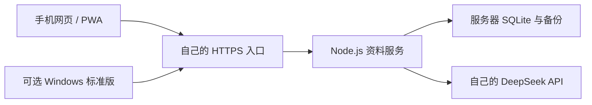

# 服务器版与手机端：Linux 部署指南

服务器版让手机与 Windows 标准版共用一份日历、任务、课表、目标和账本。你需要自行部署并维护一台常在线的 Linux 云服务器、域名和 HTTPS 入口；项目不提供公共托管账号。每个服务实例是一套共享资料，供自己或可信设备使用。



服务器在线时，Windows 电脑关机不影响手机读写资料。服务器停机或网络不可达时，共享读写和 AI 会受影响；手机已有的部分离线草稿须在恢复连接后提交。

## 1. 准备服务器与下载文件

使用具备 systemd 的 Linux；以下命令按常见 Debian/Ubuntu 目录和具备 `sudo` 权限的管理员编写。先安装 **Node.js 24**、NGINX，并准备自己的域名和可信 HTTPS 证书。软件包不附带 Node.js，已编译后端无需在服务器运行 `npm ci`。

示例 unit 使用 `/usr/local/bin/node`。先运行 `/usr/local/bin/node --version` 核对；若实际 Node 24 位于其他路径，修改 unit 的 `ExecStart`，并相应替换本文命令。域名 DNS 应指向服务器；云安全组和防火墙只为网站开放所需的 80/443，资料服务的 3210 端口保持仅回环访问。

从[服务器版与手机端 0.7.0 Release](https://github.com/Albert071006/ultimate-calendar/releases/tag/server-v0.7.0) 下载并上传到服务器同一工作目录：

- `UltimateCalendar-Server-Mobile-0.7.0.tar.gz`
- `SHA256SUMS-server.txt`

部署包包含 `dist-server/cli.mjs`、`web/` 手机静态页、`scripts/retain-web-assets.mjs` 升级辅助工具、`deploy/server-mobile/ultimate-calendar.service`、`deploy/nginx.conf.example`、许可及说明。包不包含数据库、API Key、配对凭据、证书或任何人的私人资料。

## 2. 校验并安装程序与持久目录

以下为**首次安装**，使用独立的 `ultimate-calendar-server` 用户和目录，不覆盖现有其他日历服务。后续升级见第 7 节。代码块在同一终端依次执行，遇到校验或目录冲突时先核对原因。

```sh
set -eu
sha256sum -c SHA256SUMS-server.txt

stage_dir=$(mktemp -d)
tar -xzf UltimateCalendar-Server-Mobile-0.7.0.tar.gz -C "$stage_dir"
bundle_dir="$stage_dir/UltimateCalendar-Server-Mobile-0.7.0"
test -f "$bundle_dir/dist-server/cli.mjs"
test -f "$bundle_dir/web/index.html"

getent passwd ultimate-calendar-server >/dev/null || \
  sudo useradd --system --user-group \
    --home-dir /var/lib/ultimate-calendar-server \
    --shell /usr/sbin/nologin ultimate-calendar-server

sudo install -d -o root -g root -m 0755 /opt/ultimate-calendar-server/releases
sudo test ! -e /opt/ultimate-calendar-server/releases/0.7.0
sudo cp -R "$bundle_dir" /opt/ultimate-calendar-server/releases/0.7.0
sudo chown -R root:root /opt/ultimate-calendar-server/releases/0.7.0
sudo chmod -R u=rwX,go=rX /opt/ultimate-calendar-server/releases/0.7.0
sudo ln -s /opt/ultimate-calendar-server/releases/0.7.0 /opt/ultimate-calendar-server/current

sudo install -d -o ultimate-calendar-server -g ultimate-calendar-server -m 0700 \
  /var/lib/ultimate-calendar-server \
  /var/lib/ultimate-calendar-server/data \
  /var/lib/ultimate-calendar-server/backups
```

代码在 `/opt/ultimate-calendar-server/releases/`，`current` 指向运行版本。数据库、会话和服务配置资料在 `/var/lib/ultimate-calendar-server/data`，自动安全备份在同级 `backups`；升级程序时保留这两个目录。不要把它们放入网页静态目录或代码包。

## 3. 配置并启动 systemd 服务

创建 `/etc/ultimate-calendar-server.env`，将示例域名替换为手机实际访问的 HTTPS 根地址，不带末尾斜杠、路径或查询参数：

```sh
sudo test ! -e /etc/ultimate-calendar-server.env
printf '%s\n' 'CALENDAR_ORIGIN=https://calendar.example.org' | \
  sudo tee /etc/ultimate-calendar-server.env >/dev/null
sudo chown root:root /etc/ultimate-calendar-server.env
sudo chmod 0600 /etc/ultimate-calendar-server.env

sudo install -o root -g root -m 0644 \
  /opt/ultimate-calendar-server/current/deploy/server-mobile/ultimate-calendar.service \
  /etc/systemd/system/ultimate-calendar-server.service
sudo systemd-analyze verify /etc/systemd/system/ultimate-calendar-server.service
sudo systemctl daemon-reload
sudo systemctl enable --now ultimate-calendar-server.service
sudo systemctl status ultimate-calendar-server.service --no-pager
```

unit 将后端绑定到 `127.0.0.1:3210`，使用 `--static-dir /opt/ultimate-calendar-server/current/web` 同时提供手机网页和 API。它不会自行设置 HTTPS、修改防火墙或读取另一份桌面数据库。

在服务器核对就绪状态，`Host` 使用同一个实际域名：

```sh
curl --fail --silent --show-error \
  -H 'Host: calendar.example.org' http://127.0.0.1:3210/readyz
```

应确认 `ready` 为 `true`，并检查备份状态。若响应显示备份降级，应先处理权限或磁盘问题。服务初次未配置 AI Key 也能正常启动和使用手动功能。

## 4. 配置同源 HTTPS

包内 `deploy/nginx.conf.example` 是反向代理模板。管理员先取得与实际域名匹配的证书，再将模板复制为自己的 NGINX 站点配置；按当前系统的 NGINX 组织方式启用，避免覆盖已有站点。

例如采用 `/etc/nginx/conf.d/` 的系统：

```sh
sudo test ! -e /etc/nginx/conf.d/ultimate-calendar-server.conf
sudo install -o root -g root -m 0644 \
  /opt/ultimate-calendar-server/current/deploy/nginx.conf.example \
  /etc/nginx/conf.d/ultimate-calendar-server.conf
sudoedit /etc/nginx/conf.d/ultimate-calendar-server.conf
```

把所有 `calendar.example.invalid` 替换成自己的域名，并将 `ssl_certificate`、`ssl_certificate_key` 改为真实证书路径。保留代理目标 `http://127.0.0.1:3210`、原始 Host/Origin、Cookie，以及关闭缓冲和写请求重试的设置。页面和 `/api/` 应通过同一个 HTTPS 域名提供，不要单独给 API 换域名。

```sh
sudo nginx -t
sudo systemctl reload nginx
```

在浏览器打开自己的 `https://calendar.example.org`，应出现设备配对页面，证书有效且无跨域错误。首次远程使用不要以公网 HTTP 或 IP 地址替代正式 HTTPS 地址。更改域名后，浏览器存储和设备授权可能需要重新配置。

本部署包不申请证书，也不自动配置 DNS、NGINX 或云防火墙。采用已有 HTTPS 代理或 Tailscale 时，同样保持同源转发和后端回环监听；更详细的双入口方案见仓库 `docs/public-https.md`。

## 5. 手机配对、主屏幕与 AI

在管理员终端以**服务用户**生成配对码，避免 root 创建服务用户无法读取的私有文件：

```sh
sudo -u ultimate-calendar-server /usr/local/bin/node \
  /opt/ultimate-calendar-server/current/dist-server/cli.mjs \
  pair --data-dir /var/lib/ultimate-calendar-server/data
```

在手机浏览器打开正式 HTTPS 地址，输入一次性码和设备名称。码有效期为 10 分钟，只能使用一次；每台设备需要单独生成。配对码不要放入公开截图、日志或仓库。

配对后可使用浏览器的「添加到主屏幕」功能，以 PWA 方式打开。若主屏幕实例与浏览器未共享授权，再生成一个新码，在主屏幕实例中完成配对。无需下载 Android APK 或 iOS 安装包。

在手机「我的 → AI 与费用」保存自己的 DeepSeek API Key，选择账户可用的模型。Key 保存在服务器 `data/ai-credentials.json` 中，由服务用户持有，目录为 0700、文件为 0600；这是文件权限保护，内容并未加密。已配对设备共用这份配置，接口不回显原 Key。保存 Key 不会自动发起收费模型测试。

AI 请求从服务器直连 DeepSeek，需服务器出站网络和账户额度。没有 Key 时仍能手动管理日历、任务与账本。管理员若另行使用 `--api-key-file` 或 `DEEPSEEK_API_KEY` 供应密钥，手机只可查看配置状态，不能覆盖该外部供应源。

如需手机后台推送，可在环境文件增加自己的 `VAPID_SUBJECT=mailto:实际联系邮箱`，正常重启服务，并在手机主动启用通知。推送还依赖 HTTPS、手机平台支持、主屏幕安装、通知权限及推送网络；服务运行不等于每台设备已通过锁屏送达验证。

## 6. 可选 Windows 客户端与群消息采集

同一服务器 Release 提供 `UltimateCalendar-Setup-0.7.0.exe`，这是支持云连接的 Windows 标准版。独立的 `UltimateCalendar-Local-Setup-0.7.0.exe` 始终使用本机资料，不连接此服务。

Windows 标准版需单独生成配对码，配置自己的 HTTPS 地址、独立云 profile 和受保护的配对码文件。具体字段和启动命令见包内 `docs/windows-cloud-mode.md`，或[在线 Windows 连接说明](https://github.com/Albert071006/ultimate-calendar/blob/server-v0.7.0/docs/windows-cloud-mode.md)。已有本机或云端资料不会因安装而自动迁移。

QQ 自动采集是可选扩展，仍需 Windows 上自己的 QQ 客户端和 OneBot 兼容桥。采集、原文、附件和提炼在电脑处理，可另配摘要桥上传提炼结果；服务器本身不登录 QQ。电脑关机后会暂停新的 QQ 采集，但不影响服务器已有日历和账本。配置方法见[QQ 摘要桥说明](https://github.com/Albert071006/ultimate-calendar/blob/server-v0.7.0/docs/qq-cloud-bridge.md)。

标准版也可在 Windows 上配置微信只读采集，支持选群、已同步的消息及已下载的图片和文件。微信客户端、独立 Python 依赖和可选 FFmpeg 不随安装包提供，按[微信配置指南](https://github.com/Albert071006/ultimate-calendar/blob/server-v0.7.0/docs/wechat-capture.md)完成设置。微信的原文与附件同样留在采集电脑；手机不会直接连接微信，Linux 服务器也不登录微信。电脑关机后暂停新的微信采集。

## 7. 备份、升级与恢复

**升级到 0.7.0 时，后端、Windows 标准版和手机页面需要一起更新。** 新借款类型和自定义账户数据不受旧版支持；旧客户端会提示更新，不能继续使用旧账本界面。先备份并正常停止服务，再更新后端与手机静态资源，同时更新 Windows 客户端；手机关闭旧页面后重新打开或刷新。保留数据、凭据、设备配对和环境配置，无需清空手机资料或重新填写有效 Key。具体功能见[0.7.0 发布说明](release-notes/server-0.7.0.md)。

服务写入及定期维护会生成安全 JSON 备份，保留正式日程、任务、课表、账本及关联，移除原始消息和图片。备份不包含 AI Key、设备会话或推送私钥；仍含私人资料，建议另存到受保护的备份位置。

手动备份前正常停止服务，用当前版本的 CLI 执行备份，再启动：

```sh
sudo systemctl stop ultimate-calendar-server.service
sudo -u ultimate-calendar-server /usr/local/bin/node \
  /opt/ultimate-calendar-server/current/dist-server/cli.mjs \
  backup --data-dir /var/lib/ultimate-calendar-server/data \
  --backup-dir /var/lib/ultimate-calendar-server/backups
sudo systemctl start ultimate-calendar-server.service
```

升级时先阅读目标版本说明，校验新部署包，在 `releases/` 下解压到新的版本目录，保持 root 所有、服务用户只读。正常停止服务并用旧版本备份后，再切换 `current` 指向新目录；保留原数据、备份和环境文件。若 unit 有变化，审阅后更新并执行 `daemon-reload`，最后启动服务并检查就绪、HTTPS 首页、配对状态及已保存资料。不要在运行中覆盖 SQLite 文件。

手机 PWA 升级还需保留旧页面引用的指纹资源，避免已打开的页面或主屏幕缓存请求旧脚本时得到 404。新版部署包内附 `scripts/retain-web-assets.mjs`；在 `current` 仍指向旧版、且新版目录已完整解压时执行：

```sh
sudo /usr/local/bin/node \
  /opt/ultimate-calendar-server/releases/0.7.0/scripts/retain-web-assets.mjs \
  /opt/ultimate-calendar-server/releases/0.7.0/web \
  /opt/ultimate-calendar-server/current/web
```

它只补充指纹资源，不替换新版首页或 worker；同名资源内容不一致时停止，须先核对原因。保留后不要重新生成离线清单。还需复制旧版本作为回退目录，按包内 `docs/backend-operations.md` 的手机静态资源升级规则向该副本补充新版资源。原子切换目录本身不能替代资源保留，也无需清空手机配对或待提交草稿。

保留旧代码目录可供回退；只有存储格式兼容时才能单独回退代码。保留静态资源只解决页面加载，不能让旧程序理解新账本格式。使用 0.7.0 的新借款或自定义账户后，不能仅切回旧后端、旧桌面程序或旧手机页面；需先核对数据与目标版本兼容性，并保护升级后的新增记录。需要恢复安全 JSON 时，使用全新或空资料目录，保留原资料供核对，不能直接覆盖运行库；恢复后需重新配对和配置 Key。这是明确的数据恢复流程，不是处理页面更新提示的方法。完整运行、资源预算和恢复契约见[服务运维说明](https://github.com/Albert071006/ultimate-calendar/blob/server-v0.7.0/docs/backend-operations.md)。

本指南和发布包提供可审阅的配置与操作步骤。构建及隔离测试不代表已在你的 Linux、域名、证书或手机上完成部署验收。
